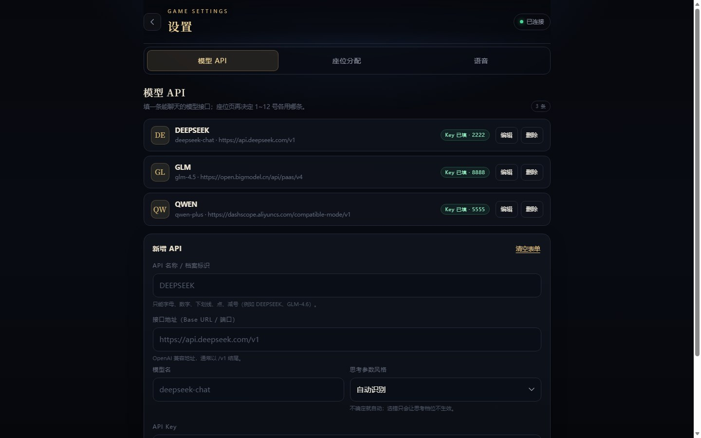
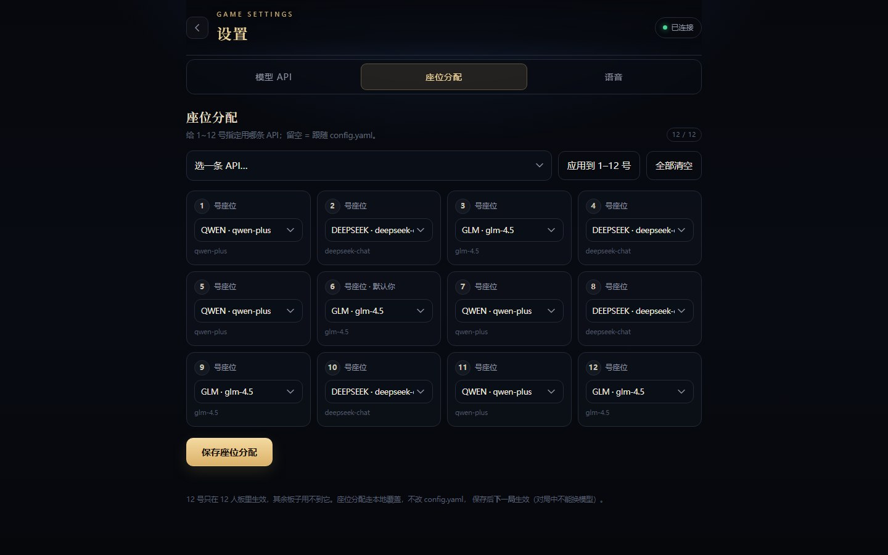
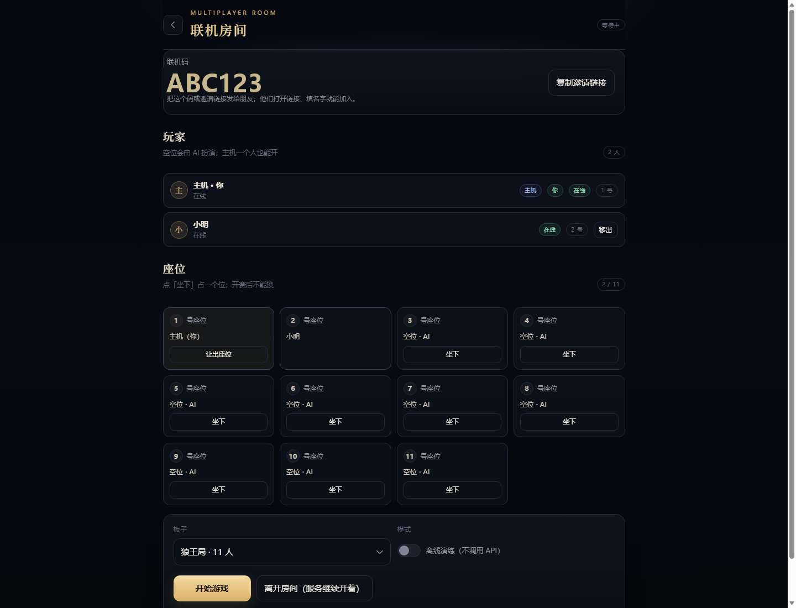

# AI 狼人杀 · Werewolf

**你坐一个座位，其余座位由大模型扮演。**

[](https://github.com/cinnabarpath9/werewolf/releases/latest)
[](https://afdian.com/a/langrensha)
[](https://qm.qq.com/q/68VcRJr3Py)
[](LICENSE)
[](https://cinnabarpath9.github.io/werewolf/web/play.html)
[](https://render.com/deploy?repo=https://github.com/cinnabarpath9/werewolf)
[](https://cinnabarpath9.itch.io/ai-werewolf-cn)

> ☕ **[爱发电 · 感谢赞助](https://afdian.com/a/langrensha)**　·　💬 **[加入 Q 群交流](https://qm.qq.com/q/68VcRJr3Py)**　·　⬇ **[夸克网盘](https://pan.quark.cn/s/00bf04be5c63)** / **[百度网盘](https://pan.baidu.com/s/1WfrytBb-xyHMDLlZUIN9Hw)**（提取码 `vv9n`）
>
> 🟢 **[在线试玩（点开即玩，填自己的 key）](https://cinnabarpath9.github.io/werewolf/web/play.html)**　·　**6 人板推荐先试**（5~10 分钟）/ 11 人板是完整流程（20~60 分钟，取决于模型与思考档）
>
> ☁️ **[云端一键部署（Render，用自己的 key）](https://render.com/deploy?repo=https://github.com/cinnabarpath9/werewolf)**　·　不想装 Python 就用这个；步骤见 §7
>
> 🎮 **[itch.io 下载页（Windows 客户端，免装 Python）](https://cinnabarpath9.itch.io/ai-werewolf-cn)**　·　解压双击 `werewolf.exe`；没 key 可先玩离线演练
>
> ⚠️ 首次运行若 Windows 弹「已保护你的电脑 / 未知发布者」：点「更多信息」→「仍要运行」
> （没有代码签名证书的常见提示，不是病毒；不放心可把 exe 传 VirusTotal 自查）

服务跑在自己电脑上，手机或电脑浏览器打开就能玩。内置完整规则引擎、信息隔离、语音（AI 发言念出来、
你也能说话输入）、逐次调用的完整留痕与复盘。没有 API key 也能先用「离线演练」打一局。


> **怎么装、怎么配、手机连不上、想换端口、想升级** → 看 **[`部署说明.md`](部署说明.md)**。
> 这份 README 只回答「它是什么、能干嘛」。

---

## 1. 它能做什么

- **真规则、真流程**：四张内置板子；警长竞选、遗言、投票 PK、狼人自爆、女巫/摄梦人/守卫的「奶穿」等细节
  都按项目口径实现，不是一个聊天套壳。
- **信息隔离**：每个 AI 只拿到自己该看到的那一份（公开信息、狼队夜间讨论、自己的私有笔记）。
  夜里不会向手机泄露「几号在思考」。
- **每个座位可以用不同的模型**：不同平台、不同 key、不同模型、不同温度，可以混搭。
- **语音**：AI 发言可以按顺序念出来；你也能按住麦克风说话（需 HTTPS 或 localhost，见部署说明 §7）。
- **完整复盘**：每次调用都留痕，能看到当时的上下文包、完整思维链、token 与耗时。
- **发言面板可收起**：轮到你发言时点「🗕 收起面板」，先把上面的发言/投票记录翻一遍，再展开继续写（输入内容不丢）。
- **失败角标 / 开局预检**：某个座位某一步没做成（调用失败/缺字段），座位上会挂 `⚠N`，
  顶部汇总「本局 N 步未完成」；选板子页会列「座位 X 还没配 key」。
- **对局结算页**：打完自动弹出「场上座位 + 全部身份 + 胜负 + 狼/神/民分布」，发言与票型点「看复盘」。
- **大厅复盘入口**：开局页「复盘 · 看历史对局」→ 只列真实模型对局（演练局不进列表）→ 点一条看该局。
- **一台主机、多人加入**：朋友用浏览器加入、各自坐一个座位；每个真人只看到自己的底牌与行动面板。
- **离线可玩**：没有 API key 也能用离线演练打完整一局，零成本验证规则。
- **轻量牌桌**：顶部点「🪑 牌桌」展开——座位围一圈、当前发言高亮、投票画箭头、
  出局变灰；结算时牌桌搬进弹窗，身份**逐张翻牌**（收起牌桌则回退身份网格）。
- **导演模式（作弊，默认关）**：设置里打开后，对局中点任意座位就能看身份；
  关着时点座位没有任何反应，服务端也不会把身份发给你（只影响主机自己，不影响别人）。
- **观战（全 AI）**：选座位页点「👁 观战（全 AI）」，不坐座位直接看一桌 AI 打完整局；
  **消耗的是开局者自己的模型额度**（没 key 就用离线演练观战）。
- **人设（可选，默认关）**：设置里给每个座位写姓名 / 性格 / 经历 / 说话风格；
  **开之前想清楚**：人设会改变模型的判断倾向、可能降低竞技强度，文字越多 token 越多。
- **法官播报**：天黑/天亮/竞选/出局/平安夜/结束等公告有预录语音（8 条，默认开），
  公告不再实时合成语音，只有 AI 发言才走 TTS。

| 大厅 | 选板子 |
| --- | --- |
|  |  |

| 设置 · 模型 API | 设置 · 座位分配 |
| --- | --- |
|  |  |

| 联机房间（一台主机，朋友加入） |
| --- |
|  |

---

## 2. 三步开始

```powershell
# 1) 解压 zip，进目录
# 2) 双击 start.bat（Windows）/ bash start.sh（macOS、Linux）
# 3) 浏览器打开 http://127.0.0.1:8077，配对码在 配对码.txt 里
```

然后：设置 → 模型 API 填一条（地址 + 模型名 + key）→ 座位分配全选它 → 回大厅「开始游戏」。

**不想填 API？** 选板子页勾「离线演练」，直接开一局，不联网也不花钱。

装不上、手机连不上、想换端口、想升级、想看日志 → 全部在 **[`部署说明.md`](部署说明.md)**：
它按「装 → 配 → 连 → 升级 → 排障」排好了，还带一张 16 条的故障对照表。

---

## 3. 四张内置板子

| 板子 | 人数 | 规则 |
| --- | --- | --- |
| **`eleven_wolfking`（默认）** | 11 | 3 狼 + 1 狼王 + 预言家/女巫/摄梦人/愚者 + 守墓人/养鸦人/幸运儿。首夜无刀，屠边 |
| `twelve_standard` | 12 | 4 狼 + 预言家/女巫/猎人/愚者 + 4 民。屠边，有警长竞选 |
| `nine_all` | 9 | 3 狼 + 预言家/女巫/猎人 + 3 民。屠城，暗牌，无警长 |
| `six_all_reveal` | 6 | 2 狼 + 预言家/女巫 + 2 民。屠城 + 出局亮身份 |

- 11 / 12 人板自动开警长竞选；9 / 6 人板没有。
- 换默认板子、自定义板子（`config.yaml` 的 `game.board` / `game.boards`）见 `部署说明.md` §6。
- **托管一手**：轮到你行动时不想自己判断，点面板上的「🤖 托管这一手」，让单独配置的托管模型替你做这一手（设置 → 模型 API → 托管模型）。
- **全程自动托管**：对局页顶部「🤖 全程托管」开关。打开后，接下来每次轮到你都自动让托管模型决策；再点一次立即关闭（正在跑的那一手会取消，面板交回给你）。适合测试模型，或接下来几手暂时不想玩。新开一局会自动关闭，避免没注意又替你打一局。
- **背景音乐**：默认播放 Erik Satie《Gymnopédie No.1》（钢琴独奏 · 公有领域录音 · CC0），可关、可调音量、可换自己的音乐（设置 → 背景音乐）。
- 完整规则口径（遗言、死因公示、弃权、平票、控场判据等）**以 `content/01_规则书.md` 为唯一一份**，
  其它文档只做引用，不重复抄规则。

---

## 4. 手机 / 一台主机多人玩

- **手机当你的手**：同一 Wi-Fi 打开 `http://<电脑局域网IP>:8077`，填配对码即可。
- **朋友一起玩**：主机开「联机房间」，把**联机码**或邀请链接发给朋友，他们填名字、坐下、等开局。
  没坐人的座位由 AI 扮演，主机自己也可以当观众。
- 只有**同一局域网 / 同一个 Tailscale 网络**内可用；没有公网房间列表、没有账号系统。
- 安卓手机也能当主机（Termux），但 **iPhone / iPad 不能当主机**，只能当玩家。

细节（两把钥匙的区别、HTTPS 与麦克风、掉线重连）都在 `部署说明.md` §7–§9。

---

## 5. 已知边界

- 单房间：同一时刻只能开一局；不支持多房间大厅。
- 联机只做**同一局域网 / 同一 Tailscale 网络**：没有公网房间列表、账号系统、自动 NAT 穿透。
- 手机当主机只支持**安卓 + Termux**；iPhone / iPad 不能当主机，只能当浏览器玩家。
- 安卓被系统限制后台时，锁屏久了服务可能被杀；建议插电并关闭 Termux 的电池优化。
- 没有丘比特 / 盗贼这类花板子，也没有剧本杀模式。
- 语音依赖第三方 TTS/ASR 服务（默认按通义千问的接口形状实现），不配就纯文字。
- AI 的行为质量取决于你接的模型；换模型前建议先跑 `python tools/test_boards.py` 看板子自检。
- 各模型在我们渠道上的实测分数（只放分数与思考档对比，不含题库、提示词和渠道信息）见
  [`模型测试分数.md`](模型测试分数.md)。**仅供参考，你自己的渠道请自己重测。**
- 想自己测：`python tools/exam_paper.py --paper basic --models my_models.yaml`
  （基础 30 / 实力 30 / 全量 60 三套卷，判据见 `模型测试分数.md` §6）。

---

## 6. 开源与反馈

- 协议：**源码可见 + 非商业**（免费玩、免费私下改；**禁止商用**；对外发布/二次开源需授权），见 [`LICENSE`](LICENSE)。
- 想改代码：先读「目录结构」与 `content/00_阅读指南.md`（哪份文档管什么、改了要同步谁），
  再动 `wolf/` 与 `web/`。打包用 `python tools/build_release.py --flavor desktop|android --zip`，
  打包后的自检用 `python tools/check_release.py dist/<包>.zip`。
- 想改首页右下角的链接：编辑 `web/site.json`（`repo` / `qq_group` / `qq_link` / `author` / `version`，留空就不显示）。

```json
{
  "repo": "https://github.com/your-name/werewolf",
  "qq_group": "123456789",
  "qq_link": "https://qm.qq.com/q/xxxxxx",
  "author": "your-name",
  "version": "1.0.0"
}
```

## 6.5 在线试玩（引擎跑在你浏览器里）

`web/play.html` 是**零安装试玩页**：页面用 Pyodide 在你自己的浏览器里跑这个项目的**真实规则引擎**，
模型调用直接打你自己填的 key —— 不需要服务器、不需要注册、也不会占任何人的额度/额度池。

- 两个板子：**6 人明牌板**（推荐试玩，5~10 分钟）/ **11 人狼王板**（完整流程，20~60 分钟，取决于模型与思考档；调用明显更慢）；
- 先勾「离线演练」可以不填 key 看流程（规则 Bot）；
- ⚠️ **浏览器直连模型要看渠道允不允许跨域（CORS）**：OpenAI 官方与多数中转可以；
  **火山方舟、千帆通常不允许**（它们要服务端调用），填了会被浏览器拦下。
  被拦时页面会直接报错，不会假装能跑 —— 这时换一个允许跨域的渠道，或改用本地版 / 云端一键部署；
- ⏳ **首次打开要下 13MB**（其中的 wasm 9.6MB 砍不掉）：页面优先用同源 `web/pyodide/`，CDN 只作回退 —— 不会被 CDN 墙住；
  但国内直连 GitHub Pages 常被限速，**等 15 秒还没好页面会直接提示「开全局代理 / VPN 后刷新」**；下过之后走浏览器缓存，第二次接近秒开；
- 已发布在 GitHub Pages：<https://cinnabarpath9.github.io/werewolf/web/play.html>（仓库 Settings → Pages，无服务器、零额度）；
  这批 pyodide 文件**不进发布包**（`build_release.py` 已排除），只服务静态托管。

## 7. 云端一键部署（用自己的 key）

仓库里带了 `Dockerfile` 和 `render.yaml`，**不用自己装 Python**：

| 平台 | 怎么做 |
|---|---|
| **Render**（推荐） | New → Blueprint → 选这个仓库，它照 `render.yaml` 建服务。部署时填 `WOLF_PAIR_CODE`（6 位；不填就每次重启随机生成） |
| **Railway / Fly / 任意容器平台** | 选「从 Dockerfile 部署」，监听 `8077`，把端口映射出来即可 |

⚠️ 三条必须知道：

1. **key 是你自己的**：云端只替你跑服务，模型 API key 仍然在「设置」里填（写进容器本地，别人看不到）；
2. **容器文件系统是临时的**：免费档**没有持久盘**，重启会丢存档与设置；要留档请换付费档挂盘，或自己在电脑跑；
3. **配对码别用默认**：公开 URL 谁都能访问，`WOLF_PAIR_CODE` 设成只有你知道的 6 位；`联机码` 只用来让朋友进房间。

> 「点开就玩、不带真实模型」的演示页**没有做**：这个项目的乐趣在真模型对局，静态演示和实际情况差很远，会把预期带偏。要宣传就用视频 + 上面的一键部署链接。

